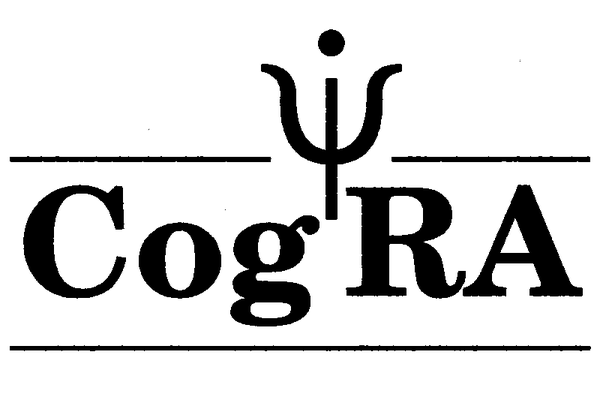
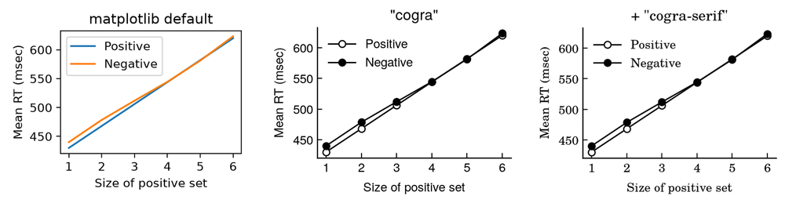
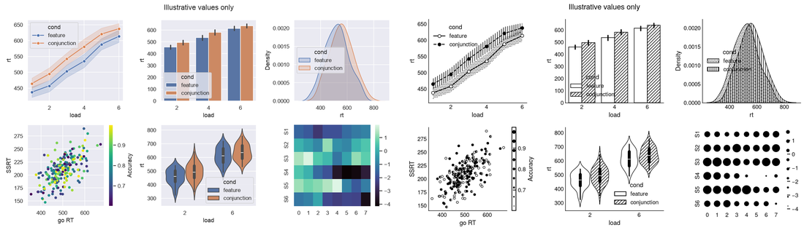
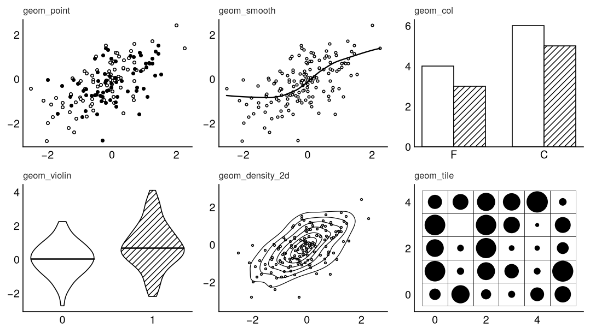
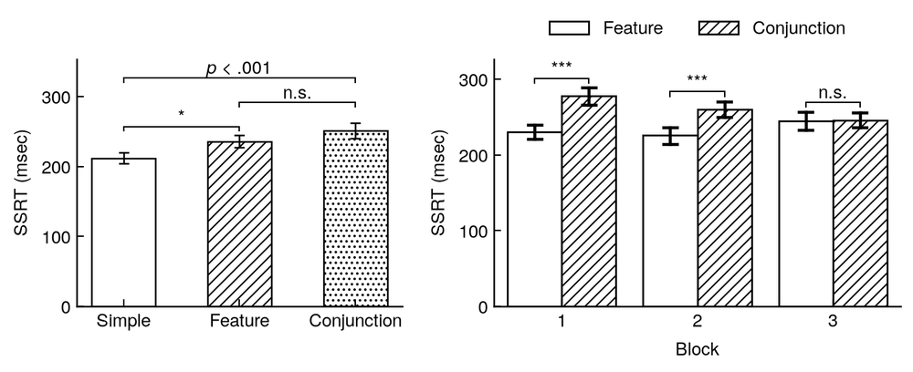
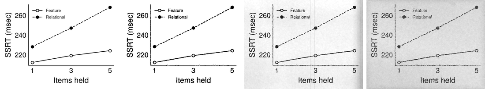
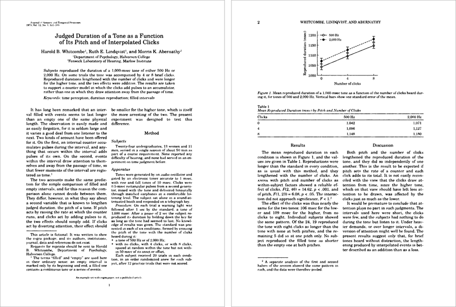

# Cognitive Revolution Aesthetic (cogra)

<p align="center"></p>

<p align="center">
<a href="https://github.com/lynde-wolf/cogra/actions/workflows/tests.yml"></a>
<a href="LICENSE"></a>

</p>

Matplotlib styles, and more, for the look of experimental psychology journals
from the cognitive revolution: black ink on white paper, groups told apart by
marker shape, line style and hatching instead of colour, and optional wear that
makes a figure look like a 1-bit archival scan, a photocopied reprint, or an
aged letterpress page. The fonts come with the package; no LaTeX needed.



- **Styles** for matplotlib: `plt.style.use("cogra")`, plus serif labels and
  figure sizes that fit a two-column page.
- **ggplot2-style geoms**, **`restyle()`** for finished matplotlib and seaborn
  figures, **significance brackets** with `signif()`, and **worn copies** with
  `save_vintage()`.
- **`cogra.paper`**: a paper in Markdown, set as an APA journal article of
  about 1980, as a web page and a PDF, with TeX math in the matching Schola
  math font.
- **Extras**: a ggplot2 theme, CSS for web pages, a LaTeX style file, and
  "scanned" fonts for slides and documents.

Step-by-step instructions for every part are in **[TUTORIAL.md](TUTORIAL.md)**,
including seaborn, pandas, plotnine, plotly and Altair.
The **[documentation site](https://lynde-wolf.github.io/cogra/)** has the tutorial, every geom with its
code, the API reference, the example papers as live pages, and the web styling
in action (the site is set in `cogra.css` itself).

## Getting started

```bash
pip install "cogra @ git+https://github.com/lynde-wolf/cogra"
```

Python 3.10+. Add `[paper]` (`"cogra[paper] @ git+..."`) for `cogra.paper`.
The base install needs only numpy, SciPy, matplotlib and Pillow: seaborn and
pandas are used by the tests, not by the package, and `restyle()` works on
their figures when you have them.

## Using the styles

Importing cogra registers its fonts and styles with matplotlib, so they work
like any other style:

```python
import matplotlib.pyplot as plt
import cogra                                   # registers the fonts and styles

plt.style.use("cogra")
plt.style.use(["cogra", "cogra-serif"])        # styles stack
plt.style.use(["cogra", "cogra-column"])       # sized for one column of a paper

with plt.style.context(["cogra", "cogra-page"]):
    fig, ax = plt.subplots()                   # 5.46 in wide, type at print size
```

| style | what it sets |
|---|---|
| `cogra` | black ink, inward ticks, no grid, open and filled markers with solid and dashed lines in turn, TeX Gyre Heros labels |
| `cogra-serif` | labels and maths in TeX Gyre Schola, the face of the page text |
| `cogra-column` | 2.65 × 2.0 in, 8 pt type: one column of the `cogra.paper` page |
| `cogra-page` | 5.46 × 3.0 in, 9 pt type: across both columns |

`cogra.use(labels="serif", size="column")` is the same as
`plt.style.use(["cogra", "cogra-serif", "cogra-column"])`.

## Examples

### Restyle a finished figure

`cogra.restyle(fig)` (or `fig | cogra.cogra()`) converts a figure made in
colour. Each colour becomes a marker, line style and hatching that are the same
in every panel and in the legend; translucent bands become stippling,
colormapped scatters open, half and filled markers, and heatmaps and colorbars
halftone dots. `fig.cogra_report` lists what was mapped to what.



### ggplot2 vocabulary

`cogra.geoms` has one function per ggplot2 geom (all 50 that ggplot2 4.0
exports), each drawn in the period style. Continuous fills (tiles, rasters,
2-D bins, hexbins) become halftone dots, because a 1-bit scan turns grey into
solid black or white. `examples/gallery.py` draws every one.



```python
from cogra import geoms as g
g.geom_point(ax, x, y, group=cond)
g.geom_smooth(ax, x, y, method="lm")
g.geom_tile(ax, xs, ys, values)
```

`cogra.bars`, `cogra.violin`, `cogra.raincloud`, `cogra.topoplot` and
`cogra.density_topo` draw the shapes a style file cannot.

### Significance brackets

`cogra.signif(ax, x1, x2, p=...)` draws a bracket with stars, an APA-style
*p* value or your own label. It sits just above everything between its two
ends, so brackets stack, and it never moves the axes. It works on seaborn
figures before or after `restyle`. In R, `signif_cogra()` does the same.

```python
cogra.signif(ax, 0, 1, p=0.03)                 # *
cogra.signif(ax, 1, 2, p=0.21, ns=True)        # n.s.
cogra.signif(ax, 0, 2, p=0.0004, show="p")     # p < .001, above both
```



### Worn copies

```python
fig.savefig("fig1.pdf")                                  # clean vector copy
cogra.save_vintage(fig, "fig1-scan.png")                 # 1-bit archival scan
cogra.save_vintage(fig, "fig1-xerox.png", look="xerox")  # photocopy of a photocopy
cogra.save_vintage(fig, "fig1-aged.png", look="aged")    # toned paper, uneven ink
```



### Papers in the 1980 journal layout

```bash
cogra-paper my_paper.md --pdf my_paper.pdf      # also writes my_paper_site/index.html
```

```python
from cogra import paper
p = paper.Paper.from_markdown("my_paper.md", figures={"rt": fig})   # 
p.save("site/")                 # paginated web page
p.pdf("my_paper.pdf")           # the same pages as a PDF
```

Two justified columns, the title block and abstract across the first page with
the author note at the foot of its first column, running heads, footnotes at
the foot of their column, and figures across the top of a page. The layout is
a baseline: `style={"body": "10pt", "page-w": "612pt", ...}` changes any page
dimension or type size, `css=[...]` adds a stylesheet, and `columns=1` gives
single-column pages. PDFs are printed with a Chrome-family browser already on
the machine (or Playwright). `examples/paper/` has three complete, invented
examples: a short 1979 report (`example.md`), and two modern theory papers
with equations, theorems, footnotes and tables:
[`regret_value_of_computation.pdf`](examples/paper/regret_value_of_computation.pdf)
(regret as the value of computation) and
[`bayes_bellman.pdf`](examples/paper/bayes_bellman.pdf).



## Things to know

- **Caching.** `save_vintage` caches worn images by the rendered figure plus
  every setting, so re-running an unchanged figure (a notebook re-run, say)
  skips the wear. The cache lives in `$COGRA_CACHE`, else `~/.cache/cogra`;
  pass `cache=False` to turn it off and call `cogra.clear_cache()` to empty it.
- **Specks.** `save_vintage` leaves dust specks off by default, because in a
  scatter plot they look like data. Pass `specks=True` to add them.
- **Seaborn palettes.** The cogra styles set the colour cycle to black, and
  seaborn's default palette follows it. Before `restyle()`, pass an explicit
  palette (`palette="deep"`) so the groups have distinct colours to map.
- **`restyle` works once per figure.** A second call warns and returns the
  figure unchanged: after the first pass the original colours are gone.
- **Continuous colour.** For a colormapped scatter, pass the values with
  `c=values, cmap=...`. Pre-computed RGBA colours look like many separate
  groups; `restyle` warns when one scatter has more groups than it has symbols.
- **Speed and reproducibility.** Wear is computed in tiles and skips paper with
  no ink nearby, so a large figure takes a few seconds (the aged look up to
  about 20). The same seed gives the same wear.

## Help and contributing

Questions, bugs and ideas are welcome as
[issues](https://github.com/lynde-wolf/cogra/issues). For a new style, look or
paper layout, please open an issue to talk it over before starting a pull
request. [CONTRIBUTING.md](CONTRIBUTING.md) covers setting up, the checks a
pull request must pass, and releases. Changes are listed in
[CHANGES.md](CHANGES.md).

## Repository layout

```
src/cogra/          the Python package
  styles/             cogra, cogra-serif, cogra-column, cogra-page (.mplstyle)
  style.py            use(), bars(), save_vintage(), violin, raincloud, topoplot, density_topo
  geoms.py            ggplot2-style geoms
  restyle.py          restyle() for finished figures
  halftone.py         draw-time-sized halftone dots
  wear.py             the scan / xerox / aged looks
  paper/              cogra.paper: Markdown to 1980-style pages (apa1980.css, paginate.js), PDF
  fonts/              TeX Gyre Heros and Schola (GUST Font License)
examples/           gallery of every geom, demos, three example papers, the README figures
assets/logo/        the CogRA wordmark, icon, favicon and social-preview card
extras/
  latex/              cogra.sty and a demo document
  web/                cogra.css, SVG filters, a specimen page
  R/                  ggplot2 theme and scales
  scanfont/           Schola Scan / Heros Scan (and Soft) TTFs, and their builder
docs/               the documentation site: build.py, site.css, about.md, check_links.py
tests/
```

## Development

```bash
uv sync --extra dev                         # .venv from uv.lock, with the test and lint tools
uv run pytest                               # the tests
uv run ruff check . && uv run mypy          # lint and type check
uv run python examples/readme_figures.py    # redraw the README figures
uv run python docs/build.py                 # build the docs site into docs/_site
```

The suite runs in about 30 seconds. `tests/test_r.py` also runs the ggplot2
theme when R and ggplot2 are installed, and the end-to-end paper test runs
when a Chrome-family browser is found; both are skipped otherwise. See
[CONTRIBUTING.md](CONTRIBUTING.md) for the checks a pull request must pass.

## Citing

You don't need to cite cogra; it is an aesthetic, not a method. But if for
whatever reason you'd like to, GitHub's "Cite this repository" button (from
`CITATION.cff`) gives the citation, or:

> Wolf Gorneault, L. (2026). *Cognitive Revolution Aesthetic (cogra)* (Version 0.1.0) [Computer software]. https://github.com/lynde-wolf/cogra

## Licences

The code is under the [MIT License](LICENSE). The fonts in `src/cogra/fonts/`
and `extras/web/fonts/` are TeX Gyre Heros and TeX Gyre Schola by GUST
e-foundry, under the GUST Font License (included). The scan fonts in
`extras/scanfont/fonts/` are derived works and are renamed ("Schola Scan",
"Heros Scan") as that licence requires.
